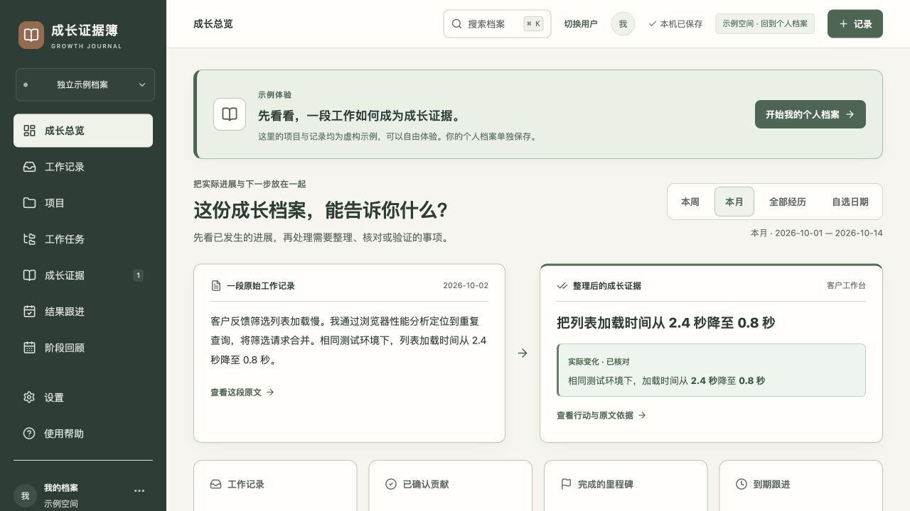

# 成长证据簿

[](https://github.com/WangFei-2019/growth-evidence-journal/actions/workflows/pages.yml)

**从工作碎片整理成长记录，让每一项贡献都有原文依据。**

成长证据簿是一款在浏览器中使用的个人工作与成长档案工具。粘贴多天日志或导入已有文档，校对日期与内容，再通过 AI 或手动方式整理持续工作、个人行动和实际结果，形成可追溯的证据卡片、时间轴和阶段回顾。

应用支持独立静态发布，访问网页无需 OpenAI 或 GitHub 账号。打开后选择或创建的是当前浏览器的本机档案。个人记录与内置虚构示例分别保存。

**在线地址（GitHub Pages 部署成功后生效）：** [打开成长证据簿](https://wangfei-2019.github.io/growth-evidence-journal/)



## 为什么需要它

工作日志常常混合着任务、计划、结果、会议和待确认事项。回顾时，很难准确回答：我具体做了什么、哪部分属于本人、结果何时发生、证据在哪里。

成长证据簿保留原文，再把经历整理成稳定的工作归属和贡献证据。AI 输出先成为待核对的草稿；事实、建议和未完成事项分别保留，确认后的证据才进入阶段回顾。

## 主要功能

| 模块 | 可以做什么 |
| --- | --- |
| 成长总览 | 按本周、本月、全部经历或自选日期查看实际进展、待核对内容和下一步行动 |
| 工作记录 | 单条记录、粘贴多天日志、上传文档或截图；按日期、项目、工作任务与状态筛选 |
| 相似记录检查 | 保存和导入前提示相同或高度相似内容；对照日期、项目和原文，选择跳过或保留；回查已保存条目 |
| 项目档案 | 管理背景、目标、本人职责、周期、状态、项目颜色与里程碑；归档保留历史 |
| 工作任务 | 为持续工作保存统一名称、标签与曾用名，跨日期和文档关联原文与证据 |
| 成长时间轴 | 按日期、事件、工作任务或项目泳道回看；项目颜色同时配有文字标识 |
| 成长证据 | 整理背景、个人行动、结果和验证条件，逐字引用原文；区分本人、团队与其他人的贡献 |
| 原文校对 | 显示记录日期、来源段落和行号；高亮待核对位置，保存核对结论并接续未处理提醒 |
| 结果跟进 | 安排结果验证，完成时补记真实观察；计划不会算作已经完成的成果 |
| 阶段回顾 | 从已确认证据编排成长回顾、述职素材或面试故事；支持 Word、PDF、Markdown 和复制 |
| 本机档案 | 同一电脑支持多个本机用户，独立保存记录、设置和 API 密钥；可选口令保护 |
| 备份与回收站 | 完整备份、恢复与合并，最近恢复点，可授权文件夹自动写入备份；回收站预览、搜索与恢复 |

## 快速体验

1. 打开网页，创建一个本机档案。新档案先显示完整的虚构示例，也可以切换到空白个人空间。
2. 在示例中查看一条工作原文如何对应到证据卡片，再回看项目、时间轴和阶段回顾。
3. 在“工作记录 → 粘贴多天日志”中粘贴下面的文字，按日期拆分并逐条校对：

```markdown
# 2026-10-12
客户反馈筛选列表加载慢。我通过性能分析定位到重复查询，整理了请求合并方案。

# 2026-10-13
我合并了筛选请求。在相同测试环境下，列表加载时间从2.4秒降至0.8秒，保存了测试记录。

# 2026-10-14
我补充了不同筛选条件的验证样例。当前尚未做线上用户测试，需要继续跟进。
```

4. 可以直接保存已校对记录或手动分组。使用 AI 时，先完成下文的模型配置。
5. 核对工作分组、个人行动、实际结果和原文引用，再确认贡献证据，生成阶段回顾。

没有模型 API 也能记录、导入、手动分组、核对证据和导出回顾。相似度提醒在本机执行，不调用模型。大幅改写但语义相同的任务，仍需要 AI 工作分组或本人判断。

## 文档、截图和附件

- 导入支持 TXT、MD、LOG、CSV、TSV、DOCX、PDF、PNG、JPG、WebP。
- 文字型文档在本机提取；截图和扫描页可以启用本机 OCR，识别结果仍需校对。
- 单份文件最多 10 MB，一次最多 5 份原文、累计 60,000 字、80 条待校对记录；超限会提示分次整理。
- 日期可以写成完整年月日、月日标题或日期范围。缺少年份时参考所选年份，并明确提示核对。
- 原文件或完整粘贴原文作为附件保留。跳过同份文档的首段时，原文附件会转移到仍保留的段落。
- 单条工作记录也可添加截图或资料附件，最多 8 个，每个不超过 10 MB。

目前资料附件归属于工作记录，尚无独立的项目资料库。备份文件夹不会扫描或自动导入复制进去的资料文档。

## 配置自己的模型 API

打开 **设置 → 模型服务**，填写：

| 配置 | 说明 |
| --- | --- |
| API 地址 | 兼容 Chat Completions 的 HTTPS 地址，可包含 `/v1` 或完整 `/chat/completions` 路径 |
| 模型名称 | 服务商实际提供的模型 ID |
| API 密钥 | 自己的有效密钥，在应用设置中填写 |

点击“测试当前配置”，连接成功后保存。静态版由浏览器直接请求模型服务，**服务商必须允许浏览器跨域访问（CORS）**。不支持跨域的服务需要另外部署兼容的 HTTPS 转发接口。

地址、模型名称和密钥保存在当前域名、当前本机用户的浏览器档案中，重新打开会自动恢复；设置中可显示或清除已保存密钥。开启本机口令保护后，密钥随档案加密。

只有连接测试、AI 工作分组和 AI 证据整理会调用模型。所选文字与必要的项目、已有任务、证据上下文会发送到配置的服务；原附件文件不直接发送。请使用适合自身资料处理需求的模型服务。

系统提示词可以在“设置 → 模型服务 → 查看当前整理规则与发送内容”阅读，对应源码为 [工作分组规则](app/lib/task-prompt.ts) 和 [成长证据整理规则](app/lib/model-contract.ts)。

AI 建议不是已经完成的成果。程序会检查结构、引用与日期；真实个人贡献、数字含义、完成状态和语义仍需本人核对。

## 数据保存与迁移

工作记录、附件、草稿、核对结论、设置和 API 密钥保存在当前浏览器的 IndexedDB 中。本机用户之间、个人空间与示例空间之间分别隔离。

可选口令保护使用 PBKDF2 与 AES-256-GCM。解锁口令不长期保存，锁定后需要重新输入；遗失口令无法解密已有档案或加密备份。

在 **设置 → 数据与恢复** 可以生成完整 JSON 备份、预览恢复、合并内容或恢复最近版本。备份包含记录、附件、证据、工作任务、核对结论、回顾与回收站；不包含模型配置和 API 密钥。开启口令保护后，备份也会加密。

支持文件夹授权的浏览器可以选择本机保存位置，自动更新完整 JSON 备份；授权过期可重新授权。不支持该能力的浏览器仍可下载备份。这里保存的是应用备份，不是自动同步的项目资料目录。

**更换域名、浏览器或设备会使用独立的本机档案。**例如从原站迁移到 GitHub Pages，需要先导出完整备份，再在新地址恢复；模型配置需在新地址重新保存一次。清理浏览器站点数据可能删除本机内容，应保留独立备份。

GitHub Pages 仅发布程序和公共资源，不会把使用者的浏览器档案自动上传到仓库。

## 在本机运行

建议使用 **Node.js 24**，最低要求为 Node.js 22.13，并安装 Git。

```bash
npm ci
npm run dev
```

打开终端打印的本机地址，默认是 `http://127.0.0.1:5174/`。开发环境与正式网站的本机档案彼此独立。

构建静态发布文件：

```bash
npm run typecheck
npm run build
```

输出位于 `pages-dist/`。`npm run build:pages` 等效，也可使用 `npm run dev:pages` 启动开发预览。构建前会从依赖复制 PDF 和 OCR 引擎资源；`public/ocr/lang/` 中的中英文训练数据需保留。

## 用本机 Git 上传整个项目

本仓库是源码版，内置 GitHub Actions 自动构建与部署。第一次上传时，GitHub 上应是一个空仓库；不要额外初始化 README、许可证或 `.gitignore`。

在本机源码目录执行：

```bash
git init -b main
git add .
git commit -m "Publish growth evidence journal"
git remote add origin git@github.com:WangFei-2019/growth-evidence-journal.git
git push -u origin main
```

已初始化或已设置远程地址时跳过对应命令。提交前可用 `git status --short` 查看内容。`.gitignore` 排除依赖、构建结果、环境文件、本机工作目录和常见凭据文件；不要将个人档案备份加入源码目录。

提交作者信息可在这个仓库内用 `git config user.name` 和 `git config user.email` 设置，不必改变全局配置。SSH 推送需要本机已经具有该 GitHub 账号的有效 SSH 授权；也可使用已认证的 HTTPS 远程地址。

## GitHub Pages 自动部署

1. 源码推送到 GitHub 的 `main` 分支。
2. 在仓库 **Settings → Pages → Build and deployment → Source** 选择 **GitHub Actions**。
3. 在 **Actions** 查看 **Publish growth journal** 工作流。首次未自动运行或此前因 Pages 未启用而失败时，可点击 **Run workflow** 或重试失败的运行。
4. 部署成功后，在 **Settings → Pages → Visit site** 获取访问地址。

[部署工作流](.github/workflows/pages.yml) 使用 Node.js 24，依次执行 `npm ci`、`npm run typecheck`、`npm run build:pages`，然后上传 `pages-dist/` 并部署。仓库子路径由 `configure-pages` 自动设置；页面使用 Hash 路由，刷新 `#/records` 等地址不依赖服务器路由。

源码版应选择 **GitHub Actions**。只有已经构建好的静态成品放在仓库根目录时，才使用“Deploy from a branch”；不要将两种方式混用。

后续修改后一次性更新：

```bash
git add .
git commit -m "Update growth evidence journal"
git push
```

推送会触发新的构建部署，无需逐个文件上传。发布后建议用无痕窗口验证示例、保存、文档导入和刷新；若要演示 AI，还需在实际域名测试模型连接与一次整理。

## 静态版的服务边界

GitHub Pages 不运行服务端接口。本仓库没有默认的共享模型密钥或云端数据库：

- AI 使用当前使用者在设置中填写的兼容 API，需跨域支持。
- “加密同步”需要另行提供兼容且允许跨域的 HTTPS 同步服务地址；不配置时仍可使用本机档案与完整备份。
- 若需要免配置 AI 体验、共享 API 用量控制或集中云端存储，需要另外部署相应后端。

## 技术与目录

采用 React、TypeScript、Vite、Tailwind CSS 和 Lucide 图标；IndexedDB 保存本机档案，Web Crypto 处理可选加密。文档处理使用 Mammoth、PDF.js 和 Tesseract.js；Word 与 PDF 导出使用 docx 和 pdf-lib。

```text
app/
  journal.tsx             应用主体与页面操作
  components/             项目、记录、证据、回顾、设置等界面
  lib/                    数据保存、模型协议、文档处理与校验
web/                      独立静态网页入口
public/                   图标、PDF 字体、OCR 引擎与语言数据
scripts/                  PDF/OCR 公共资源同步
docs/images/              虚构示例界面截图
.github/workflows/        GitHub Pages 自动部署
vite.pages.config.ts      静态构建与基础路径设置
```

第三方资源的许可证保留在 `public/ocr/` 与 `public/pdf-standard-fonts/` 对应目录中。

## 常见问题

**为什么打开后要选择档案？** 这是本机用户隔离。它不要求注册网络账号，可让多人共用一台电脑而分别记录。

**模型配置保存后还要每次填密钥吗？** 同一域名、浏览器和本机用户下会恢复。换域名、换浏览器、切换用户或清理站点数据后需另行配置。

**相似提醒是否说明录入错误？** 不一定，同一工作可能有新的进展。展开原文对照后选择跳过或保留，系统不会自动合并或删除。

**回收站在哪里？** 侧栏有独立入口，设置中也有回收站标签，可查看内容、附件和恢复条目。被证据或跟进任务引用的原文需要保留。

**上传文件会发送给模型吗？** 文档提取和 OCR 在本机运行；只有主动执行 AI 分组或整理，所选提取文字和必要上下文才发送到配置的模型服务。

**为什么 PDF 文字无法选中？** 当前 PDF 回顾导出以页面图像保留中文排版。需要可编辑正文时，可导出 Word 或 Markdown。

**AI 提示跨域连接失败怎么办？** 检查服务地址、网络与服务商 CORS 支持。GitHub Pages 不能替代服务端转发接口。

## 官方发布参考

- [将本机代码通过 Git 上传到 GitHub](https://docs.github.com/en/migrations/importing-source-code/using-the-command-line-to-import-source-code/adding-locally-hosted-code-to-github)
- [设置 GitHub Pages 发布源](https://docs.github.com/en/pages/getting-started-with-github-pages/configuring-a-publishing-source-for-your-github-pages-site)
